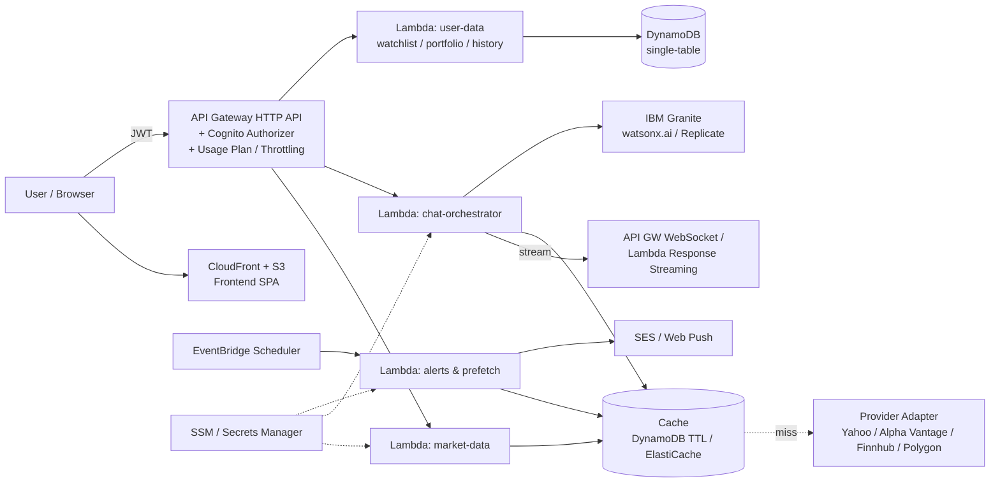

# 📈 StockAI: Rancangan Scale-Up

> Dokumen ini berisi rancangan pengembangan StockAI (granite-stock-chat) dari project portfolio menjadi produk yang siap dipakai banyak user.
> Disusun dari review kode per 21 Oktober 2026 (43 commit, branch utama).

---

## 0. Snapshot Kondisi Sekarang

| Area | Kondisi saat ini | Catatan |
|---|---|---|
| Frontend | React 18 + Vite + TS + Tailwind + shadcn/Radix | Rapi, tapi logika bisnis (routing intent, fallback, mock) ada di browser |
| Backend | 5 Lambda (Serverless Framework v3, REST API Gateway) | `stock-price`, `ai-prediction`, `technical-analysis`, `market-news`, `auth` |
| AI | Replicate dengan `meta/llama-2-7b-chat` | **Belum benar-benar IBM Granite**, walaupun branding-nya Granite |
| Data pasar | Yahoo Finance (unofficial endpoint), Alpha Vantage, NewsAPI, RapidAPI | Tidak ada cache, tidak ada abstraksi provider |
| Analisis teknikal | `Math.random()` di sekitar harga terakhir | **RSI/MACD/SMA belum dihitung dari data historis** |
| Chat | Keyword matching (`includes('predict')`, dst.) | Satu intent per pesan, tanpa konteks percakapan |
| Auth | Cognito (client-side) + Lambda `auth` | Lambda `auth` kemungkinan tidak jalan (lihat Fase 0) |
| Database | DynamoDB `StockChatUsers` didefinisikan | Belum dipakai untuk fitur apa pun |
| CI/CD | 7 workflow, `ci.yml` dinonaktifkan | Deploy lewat banyak shell script manual |
| Testing | Tidak ada | |

---

## 1. Fase 0: Fondasi (WAJIB sebelum scale) 🔴

Bagian ini bukan fitur baru, tapi hal yang akan **meledak duluan** begitu user bertambah.

### 1.1 Keamanan & secrets
- [ ] **Rotasi semua API key sekarang.** `backend/serverless.yml` punya nilai default key Replicate & RapidAPI yang di-hardcode, dan `backend/.env` ikut ter-commit ke git (`git ls-files` menunjukkan file itu ter-track). Kalau repo `gavinadlan/granite-stock-chat` publik, key itu sudah bocor, termasuk di git history.
- [ ] Hapus `backend/.env`, `backend/.serverless/*` dari git (`git rm --cached`), tambahkan ke `.gitignore`, lalu bersihkan history (`git filter-repo` / BFG).
- [ ] Pindahkan secrets ke **AWS SSM Parameter Store / Secrets Manager**, lalu referensikan di `serverless.yml` via `${ssm:/stockai/${sls:stage}/replicate-key}`.
- [ ] **Hentikan pemanggilan API pihak ketiga langsung dari browser.** Variabel `VITE_REPLICATE_API_KEY`, `VITE_NEWS_API_KEY`, `VITE_RAPIDAPI_KEY`, `VITE_ALPHA_VANTAGE_API_KEY` ikut masuk ke bundle JS dan bisa dibaca siapa pun. Semua panggilan harus lewat Lambda.
- [ ] Hapus proxy `api.allorigins.win` (pihak ketiga yang ikut melihat API key NewsAPI Anda).
- [ ] Jangan kirim `error.stack` ke client (ada di `ai-prediction.js`).
- [ ] Ganti `Access-Control-Allow-Origin: *` jadi domain sendiri (`https://stockai.gavinadlan.my.id`).

### 1.2 Kejujuran data (penting untuk aplikasi finansial)
- [ ] **Hilangkan data acak yang tampil seolah-olah data asli.** Saat ini `technical-analysis.js` membuat RSI/MACD/SMA dengan `Math.random()`, `generateMockPrediction` membuat harga prediksi acak, dan frontend membuat berita palsu dari template. User tidak bisa membedakan data asli dan data palsu.
  - Opsi minimal: kembalikan error / state "data tidak tersedia", atau beri badge **"DEMO DATA"** yang jelas.
- [ ] Samakan klaim dan implementasi: pakai model Granite sungguhan (lihat Fase 2) atau ubah copy "IBM Granite".
- [ ] Tambahkan disclaimer *"Bukan nasihat keuangan"* di setiap kartu prediksi/rekomendasi buy/sell.

### 1.3 Bug yang menghambat
- [ ] `auth.js` memakai `require('aws-sdk')` (SDK v2), yang **tidak tersedia di runtime `nodejs20.x`**, jadi perlu migrasi ke `@aws-sdk/client-cognito-identity-provider` (v3).
- [ ] IAM role Lambda hanya punya izin CloudWatch Logs, belum punya `cognito-idp:*` / `dynamodb:*` yang dibutuhkan `auth`.
- [ ] `adminInitiateAuth` dengan `ADMIN_NO_SRP_AUTH` butuh `ALLOW_ADMIN_USER_PASSWORD_AUTH` di `ExplicitAuthFlows` (sekarang hanya SRP + refresh).
- [ ] Alur register tidak konsisten: `adminCreateUser` + `adminSetUserPassword` tidak cocok dengan `confirmSignUp` di `verify`. **Saran:** buang Lambda `auth`, pakai Cognito langsung dari frontend (Amplify, yang sudah ada) dan pasang **Cognito Authorizer** di API Gateway.
- [ ] Polling Replicate (`while status === 'processing'`) tanpa batas waktu bisa menabrak timeout Lambda 60 detik.

### 1.4 Kebersihan repo
- [ ] Root `package.json` adalah duplikat dependency frontend (`vite_react_shadcn_ts`), jadi hapus atau jadikan workspace root.
- [ ] Rapikan 7 workflow + ±10 shell script deploy menjadi 1 pipeline (lihat Fase 5).
- [ ] Satukan 10+ file `.md` setup ke folder `docs/`.
- [ ] Hapus `.yarnrc*` ganda, `test.html`, `bun.lockb` + `package-lock.json` ganda (pilih satu package manager).

---

## 2. Fase 1: Backend yang Siap Banyak User 🟠

### 2.1 Arsitektur target



### 2.2 Prioritas teknis
| # | Item | Kenapa | Effort |
|---|---|---|---|
| 1 | **Layer cache** (DynamoDB dengan TTL 15–60 detik untuk quote, 1 jam untuk news, 1 hari untuk candle historis) | Rate limit Alpha Vantage (25 req/hari di free tier) & Yahoo akan habis begitu ada traffic; latency turun drastis | M |
| 2 | **Provider adapter + circuit breaker** (`MarketDataProvider` interface; fallback berurutan) | Endpoint Yahoo tidak resmi dan sering berubah/diblokir; sekarang logika fallback duplikat di frontend & backend | M |
| 3 | **Hitung indikator dari candle asli** (`technicalindicators` / `trading-signals`) via `/v8/finance/chart?range=1y&interval=1d` | Menggantikan `Math.random()`; ini nilai inti aplikasi | S |
| 4 | **Cognito Authorizer + Usage Plans** di API Gateway | Throttling per user, cegah abuse endpoint AI yang mahal | S |
| 5 | **Migrasi REST API → HTTP API** | ~70% lebih murah, latency lebih rendah, JWT authorizer native | S |
| 6 | **Shared middleware** (Middy: CORS, error handler, validasi zod, logging) | Sekarang header CORS & error copy-paste puluhan kali | S |
| 7 | **AI asinkron** untuk prediksi panjang: SQS/Step Functions, atau **Lambda response streaming** | Hindari timeout 30 detik API Gateway; UX token-by-token | M |
| 8 | **Observability**: AWS Lambda Powertools (logger, metrics, tracer) + X-Ray + alarm CloudWatch | Tahu endpoint/provider mana yang gagal | S |
| 9 | Pindah ke **TypeScript** di backend + bundling esbuild | Share tipe dengan frontend, cold start lebih kecil | M |
| 10 | Opsional: **Serverless Framework v3 → AWS CDK / SST** | SLS v4 berbayar untuk organisasi; CDK/SST lebih fleksibel untuk multi-stack | L |

---

## 3. Fase 2: AI Layer yang Benar-benar Pintar 🟡

### 3.1 Ganti keyword matching dengan LLM tool-calling
Sekarang `processMessage()` mengecek `includes('predict')` → `includes('news')` → dst., sehingga hanya bisa satu intent dan tidak paham konteks ("bandingkan dengan MSFT", "kalau yang tadi?").

**Target:** satu endpoint `/chat` yang memberi LLM daftar *tools*:
```ts
tools = [
  get_quote(symbol),
  get_history(symbol, range, interval),
  get_technical_indicators(symbol, indicators[]),
  get_news(symbol | query, since),
  get_fundamentals(symbol),          // P/E, EPS, market cap
  compare(symbols[]),
  get_user_watchlist(), add_to_watchlist(symbol)
]
```
LLM memilih tool, backend mengeksekusi, LLM merangkum. Frontend tetap merender kartu (StockCard, TechnicalAnalysisCard, dll.) dari hasil tool, sehingga komponen UI yang sudah ada tetap terpakai.

### 3.2 Model
- [ ] Pakai **IBM Granite** sungguhan (seri `ibm-granite/granite-*-instruct` di Replicate atau **watsonx.ai**). Pilih varian yang mendukung function calling.
- [ ] Abstraksi `LLMProvider` supaya bisa A/B test / fallback ke model lain.
- [ ] **Streaming** jawaban ke UI.

### 3.3 Grounding & kualitas
- [ ] **Prediksi berbasis data, bukan tebakan LLM.** LLM sebaiknya *menjelaskan*, bukan *menebak angka*. Angka proyeksi diambil dari model kuantitatif sederhana (mis. range berdasarkan volatilitas historis / ATR, atau model time-series seperti Prophet/ARIMA yang dijalankan terjadwal), lalu LLM menarasikannya.
- [ ] **RAG berita & laporan**: simpan berita + ringkasan earnings ke vector store (OpenSearch Serverless / pgvector / Bedrock Knowledge Base) agar jawaban bisa mengutip sumber.
- [ ] **Memori percakapan**: simpan history per user di DynamoDB, kirim N pesan terakhir sebagai konteks.
- [ ] **Evaluasi**: set 50–100 pertanyaan uji + jawaban yang diharapkan; jalankan setiap ganti prompt/model.
- [ ] **Guardrails**: tolak saran "pasti untung", selalu sertakan sumber + timestamp data + disclaimer.
- [ ] **Kontrol biaya**: cache jawaban identik, batasi token, kuota per tier user.

---

## 4. Fase 3: Fitur Produk 🟢

Diurutkan dari dampak terbesar terhadap retensi user.

| Fitur | Deskripsi | Ketergantungan |
|---|---|---|
| **Riwayat chat tersimpan** | Sidebar percakapan seperti ChatGPT; lanjutkan percakapan lama | DynamoDB + auth |
| **Watchlist** | Simpan saham favorit, harga live di sidebar | DynamoDB, cache quote |
| **Price alerts** | "Kabari saya kalau BBCA turun di bawah 9.000" → email / web push | EventBridge Scheduler + SES / Web Push |
| **Portfolio tracker** | Input transaksi → P/L, alokasi, dividen | DynamoDB |
| **Chart interaktif** | Candlestick + overlay indikator (lightweight-charts by TradingView) | Endpoint history |
| **Pasar Indonesia (IDX)** | Ticker `.JK`, format Rupiah, berita lokal, jam bursa WIB | Provider yang mendukung IDX |
| **Bahasa Indonesia (i18n)** | UI + jawaban AI dalam Bahasa Indonesia | `react-i18next`, prompt multi-bahasa |
| **Perbandingan saham** | "Bandingkan AAPL vs MSFT" → tabel + chart | Tool `compare` |
| **Screener** | "Saham teknologi P/E < 20, RSI < 30" | Data fundamental + prefetch terjadwal |
| **Kalender earnings & dividen** | Notifikasi event penting di watchlist | Provider fundamental |
| **Daily briefing** | Ringkasan pagi watchlist via email | Scheduler + LLM |
| **PWA / Mobile** | Installable, push notification; nanti React Native/Expo | Service worker |
| **Share insight** | Link publik ke satu jawaban/analisis (growth loop) | Snapshot ke S3 |

---

## 5. Fase 4: Frontend 🔵

- [ ] **Pindahkan logika bisnis ke backend**: `stockMarketAPI.ts` (526 baris) berisi intent routing, fallback, mock. Frontend cukup memanggil `/chat` dan merender.
- [ ] Manfaatkan **TanStack Query** (sudah terpasang) untuk cache & revalidation quote/watchlist.
- [ ] **Code splitting** per route (`React.lazy`) agar landing page ringan; chat & settings di-load terpisah.
- [ ] Bersihkan dependency yang tidak dipakai (banyak paket Radix, `replicate`, `sharp` di frontend, `lovable-tagger`).
- [ ] Hapus 3 implementasi auth paralel (`authService.ts`, `cognitoAuthService.ts`, `useAuth`) menjadi satu.
- [ ] Aksesibilitas (focus state, aria-live untuk pesan chat baru), dark mode konsisten.
- [ ] Error boundary + state kosong/gagal yang jujur (bukan fallback ke data palsu).
- [ ] Monitoring client: Sentry / CloudWatch RUM.

---

## 6. Fase 5: DevOps, Testing, Kualitas ⚙️

- [ ] **Satu pipeline GitHub Actions**: lint → typecheck → test → build → deploy `dev` (setiap push ke `main`) → deploy `prod` (manual approval / tag).
- [ ] **OIDC GitHub → AWS** (tanpa access key permanen di secrets).
- [ ] **Stage terpisah** `dev` / `prod` dengan stack, domain, dan secrets sendiri.
- [ ] **Testing**:
  - Unit: kalkulasi indikator, parser symbol, adapter provider (Vitest).
  - Integration: Lambda handler dengan provider di-mock.
  - E2E: alur login → chat → watchlist (Playwright).
- [ ] Monorepo (`pnpm` workspaces / Turborepo): `apps/web`, `apps/api`, `packages/shared-types`.
- [ ] Dependabot + `npm audit` di CI.
- [ ] Budget alarm AWS + dashboard biaya per endpoint (AI paling mahal).

---

## 7. Fase 6: Bisnis & Monetisasi (opsional) 💰

| Tier | Isi | Implementasi |
|---|---|---|
| Free | 20 pertanyaan AI/hari, 5 watchlist, data delay 15 menit | Usage Plan API GW + counter DynamoDB |
| Pro | Unlimited chat, alerts, portfolio, data real-time, daily briefing | Midtrans / Xendit (IDR) atau Stripe |
| API | Endpoint analisis untuk developer | API key + usage plan |

> ⚠️ **Legal:** sebelum monetisasi, cek lisensi data (Yahoo Finance tidak untuk penggunaan komersial; perlu provider berlisensi seperti Polygon, Finnhub, Twelve Data, atau data IDX resmi) dan regulasi OJK terkait layanan yang memberi rekomendasi investasi.

---

## 8. Roadmap Ringkas

| Sprint (2 minggu) | Fokus | Output |
|---|---|---|
| 1 | Fase 0 | Key dirotasi, secrets di SSM, semua API call lewat backend, mock data dihapus/diberi label, auth diperbaiki |
| 2 | Fase 1 (#1–#4) | Cache, provider adapter, indikator asli, Cognito Authorizer + throttling |
| 3 | Fase 2.1–2.2 | Endpoint `/chat` dengan tool-calling + Granite asli + streaming |
| 4 | Fase 3 (history + watchlist) + Fase 5 (CI/CD) | Chat tersimpan, watchlist, pipeline otomatis |
| 5 | Fase 3 (alerts, chart, IDX) | Price alert, candlestick chart, dukungan saham Indonesia |
| 6 | Fase 2.3 + polish | RAG berita, eval set, observability, i18n |

## 9. Metrik Keberhasilan

- **Teknis:** p95 latency quote < 300 ms (cache hit), p95 chat first-token < 2 dtk, error rate < 1%, cache hit ratio > 80%.
- **Biaya:** biaya AWS + LLM per 1.000 pesan chat tercatat dan di bawah target.
- **Produk:** DAU/WAU, % user dengan ≥ 1 watchlist, retensi D7, jumlah alert aktif.
- **Kualitas AI:** skor eval set, % jawaban dengan sumber, laporan "jawaban salah" dari user.

---

## 10. Quick Wins (bisa dikerjakan hari ini)

1. Rotasi key Replicate, RapidAPI, NewsAPI, Alpha Vantage.
2. `git rm --cached backend/.env backend/.serverless -r` + update `.gitignore`.
3. Hapus default key dari `serverless.yml`.
4. Ganti `Math.random()` di `technical-analysis.js` dengan perhitungan RSI/SMA/MACD dari candle 1 tahun.
5. Ganti model `meta/llama-2-7b-chat` ke model IBM Granite instruct.
6. Tambahkan disclaimer + badge sumber data di setiap kartu.
7. Aktifkan kembali `ci.yml` (lint + build) untuk setiap PR.
