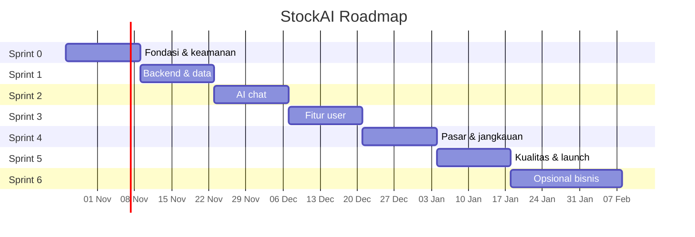
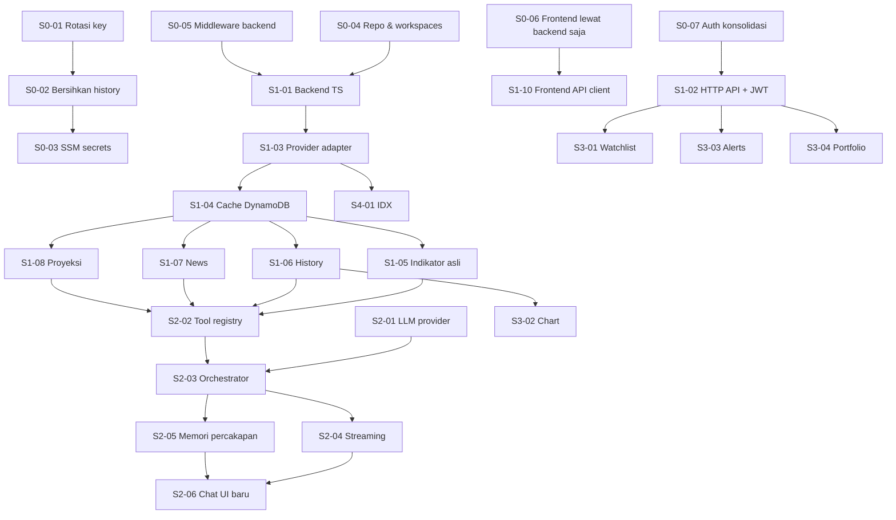

# 🗺️ StockAI Roadmap: dari Portfolio ke Produk

> Turunan detail dari [`../SCALE_UP_PLAN.md`](../SCALE_UP_PLAN.md). Setiap task punya ID, dependensi, kriteria penerimaan, dan **prompt siap tempel untuk Claude Code CLI**.
> Asumsi kapasitas: 1 developer part-time (~15–20 jam/minggu), sprint 2 minggu. Kalau full-time, durasi bisa dipangkas sekitar setengahnya.

## Daftar Isi
| Sprint | File | Fokus | Minggu |
|---|---|---|---|
| 0 | [sprint-0-fondasi.md](sprint-0-fondasi.md) | Keamanan, kejujuran data, bersih-bersih repo, CI dasar | 1–2 |
| 1 | [sprint-1-backend-data.md](sprint-1-backend-data.md) | Backend TypeScript, provider data, cache, indikator asli | 3–4 |
| 2 | [sprint-2-ai-chat.md](sprint-2-ai-chat.md) | Chat orchestrator Granite + tool-calling + streaming + memori | 5–6 |
| 3 | [sprint-3-fitur-user.md](sprint-3-fitur-user.md) | Watchlist, chart candlestick, price alert, portfolio | 7–8 |
| 4 | [sprint-4-pasar-jangkauan.md](sprint-4-pasar-jangkauan.md) | Saham IDX, i18n, perbandingan, fundamental, daily briefing, PWA | 9–10 |
| 5 | [sprint-5-kualitas-launch.md](sprint-5-kualitas-launch.md) | Performa, E2E, CI/CD penuh, security, monitoring, launch | 11–12 |
| 6 | [sprint-6-opsional-bisnis.md](sprint-6-opsional-bisnis.md) | RAG berita, tier & pembayaran, lisensi data (opsional) | 13+ |

## Timeline



## Peta Dependensi Utama



## Cara Eksekusi dengan Claude Code CLI

### Sekali di awal
1. Pastikan `CLAUDE.md` di root repo sudah ada (sudah dibuat). Claude Code membacanya otomatis, jadi prompt per task bisa lebih singkat.
2. Commit dulu file roadmap ini: `git add CLAUDE.md SCALE_UP_PLAN.md roadmap && git commit -m "docs: add roadmap and CLAUDE.md"`.

### Ritme per task
```bash
git checkout main && git pull
git checkout -b feat/S1-03-provider-adapter   # nama branch sesuai ID task
claude                                         # buka Claude Code di root repo
```
Lalu:
1. **Tempel prompt** dari file sprint (blok `PROMPT`).
2. Untuk task bertanda 🧠 (besar/berisiko), minta rencana dulu: tambahkan *"Buat rencana dulu, tunggu persetujuan saya sebelum mengubah file."* di akhir prompt, atau aktifkan plan mode.
3. Review diff. Jalankan perintah di bagian **Verifikasi** task.
4. Commit dengan pesan yang disarankan, push, buka PR (CI akan jalan setelah S0-09).
5. Centang task di tabel progres di bawah.
6. Mulai task berikutnya di sesi bersih (`/clear`) agar konteks tidak tercampur.

### Legenda
| Tanda | Arti |
|---|---|
| 🤖 | Bisa dikerjakan penuh oleh Claude Code |
| 🧑 | Langkah manual oleh Anda (dashboard AWS/provider, keputusan, akun) |
| 🤝 | Campuran: Claude Code mengerjakan kode, Anda menjalankan langkah manual |
| 🧠 | Task besar/berisiko, minta rencana dulu |
| ⏱️ | Estimasi jam kerja |

### Prompt umum yang berguna
**Lanjutkan task yang terputus:**
```
Lanjutkan task <ID> dari roadmap/<file-sprint>.md. Cek git diff & git log untuk melihat apa yang sudah dikerjakan, lalu selesaikan sisanya sesuai kriteria penerimaan.
```
**Review sebelum merge:**
```
Review perubahan di branch ini terhadap main untuk task <ID>. Cek: kriteria penerimaan di roadmap terpenuhi, aturan WAJIB di CLAUDE.md tidak dilanggar (secret, Math.random, CORS, zod, stack trace), test cukup, tidak ada kode mati. Berikan daftar temuan berurutan dari paling penting; jangan ubah file.
```
**Penutup sprint:**
```
Sprint <N> selesai. Baca roadmap/<file-sprint>.md, cek setiap task terhadap kode saat ini, lalu: (1) laporkan task yang belum memenuhi kriteria penerimaan, (2) update CLAUDE.md bagian Struktur & Perintah, (3) update README.md utama bila fitur berubah, (4) usulkan versi tag (semver).
```

## Tabel Progres

| ID | Task | Tipe | ⏱️ | Status |
|---|---|---|---|---|
| **S0-01** | Rotasi semua API key | 🧑 | 1 | ☐ |
| **S0-02** | Hapus secrets dari repo & git history | 🤝 | 2 | ✅ |
| **S0-03** | Secrets ke SSM Parameter Store | 🤝 | 2 | ✅ |
| **S0-04** | Bersih-bersih repo + npm workspaces | 🤖 | 3 | ✅ |
| **S0-05** | Middleware backend (CORS, error, validasi) | 🤖 | 3 | ✅ |
| **S0-06** | Frontend hanya lewat backend, hapus mock | 🤖🧠 | 5 | ✅ |
| **S0-07** | Konsolidasi auth (Cognito via Amplify) | 🤖🧠 | 4 | ✅ |
| **S0-08** | Disclaimer + badge sumber data | 🤖 | 2 | ✅ |
| **S0-09** | CI dasar + Vitest | 🤖 | 3 | ✅ |
| **S0-10** | Verifikasi, deploy, tag v0.2.0 | 🤝 | 2 | 🟡 kode selesai, deploy & tag manual |
| **S1-01** | Backend → TypeScript + esbuild + struktur baru | 🤖🧠 | 6 | ☐ |
| **S1-02** | HTTP API + Cognito JWT authorizer + stage | 🤝🧠 | 4 | ☐ |
| **S1-03** | Provider adapter + retry + circuit breaker | 🤖 | 6 | ☐ |
| **S1-04** | DynamoDB single-table + cache | 🤖 | 4 | ☐ |
| **S1-05** | Indikator teknikal asli | 🤖 | 5 | ☐ |
| **S1-06** | Endpoint history (candle) | 🤖 | 2 | ☐ |
| **S1-07** | Endpoint news nyata + cache | 🤖 | 3 | ☐ |
| **S1-08** | Proyeksi kuantitatif (ganti prediksi acak) | 🤖 | 4 | ☐ |
| **S1-09** | Observability (Powertools, alarm, budget) | 🤝 | 3 | ☐ |
| **S1-10** | Frontend API client + TanStack Query | 🤖 | 4 | ☐ |
| **S2-01** | LLM provider abstraction + Granite | 🤝 | 4 | ☐ |
| **S2-02** | Tool registry (zod) | 🤖 | 3 | ☐ |
| **S2-03** | Chat orchestrator | 🤖🧠 | 8 | ☐ |
| **S2-04** | Streaming (Function URL + SSE) | 🤖🧠 | 5 | ☐ |
| **S2-05** | Memori percakapan | 🤖 | 4 | ☐ |
| **S2-06** | Chat UI baru (stream + kartu + sidebar) | 🤖🧠 | 8 | ☐ |
| **S2-07** | System prompt + guardrails | 🤖 | 3 | ☐ |
| **S2-08** | Eval set + script eval | 🤖 | 4 | ☐ |
| **S2-09** | Kuota per user | 🤖 | 2 | ☐ |
| **S3-01** | Watchlist | 🤖 | 5 | ☐ |
| **S3-02** | Chart candlestick + overlay indikator | 🤖 | 5 | ☐ |
| **S3-03** | Price alerts + scheduler + email | 🤝🧠 | 8 | ☐ |
| **S3-04** | Portfolio tracker | 🤖🧠 | 8 | ☐ |
| **S3-05** | Preferensi user | 🤖 | 3 | ☐ |
| **S4-01** | Dukungan saham IDX | 🤖 | 6 | ☐ |
| **S4-02** | i18n ID/EN | 🤖 | 4 | ☐ |
| **S4-03** | Perbandingan saham | 🤖 | 3 | ☐ |
| **S4-04** | Fundamental + kalender earnings/dividen | 🤖 | 5 | ☐ |
| **S4-05** | Daily briefing email | 🤝 | 4 | ☐ |
| **S4-06** | PWA | 🤖 | 3 | ☐ |
| **S4-07** | Share insight link | 🤖 | 3 | ☐ |
| **S5-01** | Performa frontend | 🤖 | 4 | ☐ |
| **S5-02** | E2E Playwright | 🤖 | 5 | ☐ |
| **S5-03** | CI/CD penuh + OIDC | 🤝 | 4 | ☐ |
| **S5-04** | Security hardening | 🤝 | 4 | ☐ |
| **S5-05** | Monitoring frontend + dashboard | 🤝 | 3 | ☐ |
| **S5-06** | Landing page, docs, CV, launch | 🤝 | 4 | ☐ |
| **S6-01** | RAG berita | 🤖🧠 | 8 | ☐ |
| **S6-02** | Tier & kuota berbayar | 🤖 | 5 | ☐ |
| **S6-03** | Pembayaran (Midtrans/Xendit) | 🤝🧠 | 8 | ☐ |
| **S6-04** | Lisensi data & legal | 🧑 | 4 | ☐ |

**Total estimasi** Sprint 0–5 ≈ 190 jam (± 10–13 minggu part-time).

## Milestone Rilis
| Versi | Setelah | Isi |
|---|---|---|
| v0.2.0 | Sprint 0 | Aman, jujur, CI hijau |
| v0.3.0 | Sprint 1 | Data asli + cache + indikator benar |
| v0.4.0 | Sprint 2 | Chat AI Granite generasi baru |
| v0.5.0 | Sprint 3 | Watchlist, chart, alert, portfolio |
| v0.6.0 | Sprint 4 | IDX + Bahasa Indonesia |
| **v1.0.0** | Sprint 5 | Public launch |
