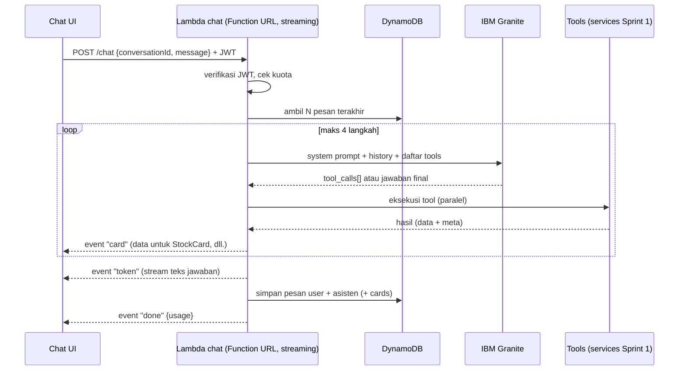

# Sprint 2: AI Chat Generasi Baru, IBM Granite + Tool-Calling (Minggu 5–6)

**Tujuan sprint:** chat memahami bahasa natural (multi-intent, konteks percakapan), memanggil tool data asli, menjawab secara streaming dengan kartu visual, dan percakapan tersimpan.
**Rilis:** `v0.4.0`

## Arsitektur Chat



**Format event SSE:**
```
event: status   data: {"text":"Mengambil data AAPL…"}
event: card     data: {"type":"quote","data":{...},"meta":{...}}
event: token    data: {"t":"Harga AAPL "}
event: done     data: {"messageId":"...","usage":{"inputTokens":..,"outputTokens":..}}
event: error    data: {"code":"QUOTA_EXCEEDED","message":"..."}
```

---

## S2-01 🤝 LLM provider abstraction + IBM Granite (⏱️ 4 jam)
**Manual dulu:** buka replicate.com/ibm-granite, pilih model **Granite instruct terbaru** (catat model id & apakah mendukung tool/function calling serta context length). Alternatif: IBM watsonx.ai (butuh akun IBM Cloud + project id). Simpan pilihan di SSM: `/stockai/{stage}/llm-model`.

**PROMPT:**
```text
Task S2-01. Model yang saya pilih: <MODEL_ID dari Replicate>, context <N> token, tool calling: <ya/tidak>.
1. backend/src/llm/types.ts: interface LLMProvider { name; chat(req: { system: string; messages: LLMMessage[]; tools?: ToolSpec[]; maxTokens; temperature; stream?: boolean; signal?: AbortSignal }): Promise<LLMResponse> | AsyncIterable<LLMChunk> } dengan LLMMessage role user|assistant|tool, dan LLMResponse { text?, toolCalls?: {id,name,arguments}[], usage }.
2. llm/replicate-granite.ts: implementasi via Replicate HTTP API (POST /v1/models/{owner}/{name}/predictions dengan header Prefer: wait, atau streaming via URL stream SSE dari respons). Timeout total 25 dtk, batas polling.
3. Jika model TIDAK mendukung native tool calling, implementasikan tool calling berbasis JSON: daftar tool dimasukkan ke system prompt, model diminta menjawab HANYA JSON {"tool_calls":[{"name":..,"arguments":{..}}]} atau {"final":true}; parse dengan zod, perbaiki sekali jika JSON tidak valid (re-prompt singkat), lalu fallback ke jawaban teks.
4. llm/index.ts: factory dari config (LLM_PROVIDER, LLM_MODEL). Siapkan stub llm/watsonx.ts (belum diimplementasi, lempar NotImplemented) agar mudah ditambah.
5. Catat usage token & latency ke metrics Powertools (LLMLatency, LLMTokens).
6. Test unit parser JSON tool-call (valid, JSON dalam code fence, invalid → repair) dengan respons model di-mock.
7. Hapus kode Replicate lama di ai-prediction (sudah diganti projection di S1-08).
Commit: "feat(ai): LLM provider abstraction with IBM Granite via Replicate [S2-01]"
```

---

## S2-02 🤖 Tool registry (⏱️ 3 jam)
**Tools awal:**
| Tool | Argumen | Sumber | Kartu UI |
|---|---|---|---|
| `get_quote` | symbol | services/market-data | `quote` → StockCard |
| `get_price_history` | symbol, range, interval | market-data | `history` → mini chart |
| `get_technicals` | symbol | services/technicals | `technicals` → TechnicalAnalysisCard |
| `get_projection` | symbol, horizon | services/projection | `projection` → PredictionChart |
| `get_news` | symbol? / query?, limit | services/news | `news` → NewsCard list |
| `search_symbol` | query (nama perusahaan) | Yahoo search / daftar lokal | – |
| `compare_symbols` | symbols[2..4] | (Sprint 4) | `comparison` |
| `get_watchlist` / `add_to_watchlist` | – / symbol | (Sprint 3) | `watchlist` |

**PROMPT:**
```text
Task S2-02. Buat backend/src/ai/tools/:
1. Tipe Tool<TArgs, TResult> { name; description (Inggris, jelas, kapan dipakai); argsSchema: zod; execute(args, ctx: {userId, locale, signal}): Promise<{ data: TResult; meta; card?: { type, data, meta } }> }.
2. Implementasi get_quote, get_price_history, get_technicals, get_projection, get_news, search_symbol (search via https://query1.finance.yahoo.com/v1/finance/search?q= melalui provider baru, cache 1 hari) memakai services Sprint 1, JANGAN memanggil HTTP endpoint sendiri.
3. registry.ts: daftar tool, fungsi toToolSpecs() (JSON schema dari zod via zod-to-json-schema), executeToolCall(call) yang memvalidasi argumen, membatasi waktu 8 dtk per tool, dan mengubah error menjadi hasil { error: { code, message } } agar model bisa menjelaskan ke user.
4. Ringkas hasil untuk konteks LLM: fungsi summarizeForLLM(result) yang memangkas data besar (mis. history → hanya statistik & 10 titik), supaya hemat token. Data lengkap tetap dikirim ke UI via card.
5. Test: validasi argumen salah, timeout tool, summarizeForLLM.
Commit: "feat(ai): tool registry backed by market data services [S2-02]"
```

---

## S2-03 🤖🧠 Chat orchestrator (⏱️ 8 jam)
**Kriteria penerimaan:**
- Loop maks 4 langkah tool; tool calls dalam satu langkah dieksekusi paralel
- Mendukung multi-intent: "harga dan RSI BBCA, plus berita terbarunya"
- Mendukung referensi konteks: "kalau yang tadi dibandingkan sama MSFT?"
- Output: teks final + daftar `cards` terstruktur
- Bisa diuji tanpa streaming (mode JSON) untuk eval

**PROMPT:**
```text
Task S2-03. Buat rencana dulu.
Buat backend/src/ai/orchestrator.ts: runChat({ userId, conversationId, message, history, locale, onEvent }) dengan:
1. Bangun messages: system prompt (dari src/ai/prompts/system.ts, dibuat di S2-07; untuk sekarang placeholder yang wajar) + history (maks 12 pesan terakhir, dipangkas sesuai budget token ~6k) + pesan user.
2. Loop maksimal 4 iterasi: panggil LLM dengan tools → jika ada tool_calls, emit event status ("Mengambil data AAPL…"), eksekusi paralel via registry, emit event card untuk setiap hasil yang punya card, tambahkan hasil (summarizeForLLM) sebagai pesan role tool → ulangi. Jika tidak ada tool_calls → jawaban final.
3. Deduplikasi tool call identik dalam satu percakapan putaran (cache hasil di memori per request).
4. Jika iterasi habis, minta model menjawab final tanpa tools.
5. Kembalikan { text, cards[], usage, toolTrace[] } dan juga panggil onEvent untuk streaming (S2-04).
6. Handler non-streaming POST /v1/chat (httpApi + JWT) untuk testing dan fallback.
7. Test orchestrator dengan LLM palsu (scripted responses): satu tool, dua tool paralel, tool error, model mengembalikan JSON rusak, batas iterasi.
Commit: "feat(ai): tool-calling chat orchestrator [S2-03]"
```

---

## S2-04 🤖🧠 Streaming (Lambda Function URL + SSE) (⏱️ 5 jam)
**Catatan:** API Gateway HTTP API tidak meneruskan streaming, jadi pakai **Lambda Function URL** dengan `InvokeMode: RESPONSE_STREAM`, dan JWT diverifikasi di dalam fungsi.

**PROMPT:**
```text
Task S2-04.
1. Fungsi baru chatStream di serverless.yml dengan Function URL (url: { invokeMode: RESPONSE_STREAM, cors: origins dari ALLOWED_ORIGINS, allowedHeaders Authorization & Content-Type }). Verifikasi dukungan invokeMode di versi Serverless yang terpasang; jika tidak didukung, definisikan AWS::Lambda::Url lewat resources. Timeout fungsi 60 dtk, memory 1024.
2. Handler memakai awslambda.streamifyResponse; set content-type text/event-stream, tulis event SSE sesuai format di roadmap/sprint-2-ai-chat.md. Kirim komentar heartbeat ": ping" tiap 10 dtk.
3. Verifikasi JWT Cognito di dalam handler dengan aws-jwt-verify (CognitoJwtVerifier tokenUse access). 401 jika tidak valid.
4. Hubungkan ke orchestrator (onEvent) dan stream token LLM jika provider mendukung streaming; jika tidak, kirim teks final dipecah per kalimat.
5. Tangani client disconnect (AbortController) agar pemanggilan LLM dihentikan.
6. Tambahkan output CloudFormation ChatStreamUrl; dokumentasikan VITE_CHAT_STREAM_URL di frontend/.env.example.
7. Script dev scripts/chat-stream.sh yang memakai curl -N untuk menguji stream dengan token dari env.
Commit: "feat(ai): streaming chat via Lambda Function URL and SSE [S2-04]"
```

---

## S2-05 🤖 Memori percakapan (⏱️ 4 jam)
**PROMPT:**
```text
Task S2-05. Simpan percakapan di tabel single-table (desain di sprint-1 S1-04):
- Conversation: PK USER#<sub>, SK CONV#<createdAtISO>#<id>, atribut title, updatedAt, lastMessagePreview.
- Message: PK CONV#<id>, SK MSG#<ts>#<id>, role, text, cards (JSON, dipangkas maksimal 50KB), usage.
1. services/conversations.ts: createConversation, listConversations(userId, cursor), getMessages(convId, limit, cursor) dengan cek kepemilikan (conversation harus milik userId), appendMessages, renameConversation, deleteConversation (hapus pesan via batch).
2. Judul otomatis: setelah jawaban pertama, buat judul ≤ 6 kata via LLM dengan maxTokens kecil (fallback: 40 karakter pertama pesan user).
3. Endpoint httpApi + JWT: GET /v1/conversations, GET /v1/conversations/{id}/messages, PATCH /v1/conversations/{id}, DELETE /v1/conversations/{id}.
4. chatStream: jika conversationId kosong, buat baru dan kirim event "meta" {conversationId} di awal stream; muat history dari DB.
5. Test kepemilikan (user A tidak bisa membaca percakapan user B) dengan aws-sdk-client-mock.
Commit: "feat(ai): persistent conversations and message history [S2-05]"
```

---

## S2-06 🤖🧠 Chat UI baru (⏱️ 8 jam)
**Kriteria penerimaan:**
- Teks muncul bertahap (streaming), kartu muncul begitu tool selesai
- Sidebar riwayat percakapan (buat baru, ganti nama, hapus), responsif (drawer di mobile)
- Tombol stop generate, salin jawaban, regenerate
- Saran pertanyaan (chips) di percakapan kosong
- `stockMarketAPI.ts` (keyword routing) dihapus

**PROMPT:**
```text
Task S2-06. Buat rencana dulu.
1. frontend/src/features/chat/: 
   - useChatStream(): kirim POST ke VITE_CHAT_STREAM_URL via fetch + ReadableStream (bukan EventSource karena butuh header Authorization), parser SSE, state { messages, streaming, status, error }, abort().
   - useConversations(): TanStack Query untuk list/rename/delete; pesan lama via getMessages.
   - Komponen: ChatLayout (sidebar + panel), ConversationList, MessageList (auto-scroll pintar: hanya jika user di bawah), MessageBubble (render markdown aman dengan react-markdown + remark-gfm, tanpa raw HTML), CardRenderer (switch card.type → StockCard/TechnicalAnalysisCard/PredictionChart/NewsCard/mini chart), StatusLine, Composer (Enter kirim, Shift+Enter baris baru, tombol stop), SuggestionChips.
2. Route /chat dan /chat/:conversationId.
3. Hapus frontend/src/services/stockMarketAPI.ts dan kode ChatInterface lama yang tidak terpakai; pindahkan komponen yang masih dipakai.
4. Aksesibilitas: aria-live="polite" untuk pesan asisten, fokus kembali ke composer setelah kirim.
5. Error: QUOTA_EXCEEDED → banner dengan info reset; jaringan putus → tombol coba lagi tanpa kehilangan input.
6. Test komponen: parser SSE (chunk terpotong di tengah event), CardRenderer per tipe.
Commit: "feat(web): streaming chat UI with conversation history and data cards [S2-06]"
```

---

## S2-07 🤖 System prompt + guardrails (⏱️ 3 jam)
**PROMPT:**
```text
Task S2-07. Buat backend/src/ai/prompts/system.ts (versi diberi nomor, mis. SYSTEM_PROMPT_V1) berisi:
- Peran: asisten riset pasar saham StockAI, menjawab dalam bahasa user (Indonesia/Inggris).
- WAJIB memakai tool untuk angka apa pun (harga, indikator, berita, proyeksi). Dilarang mengarang angka, tanggal, atau berita. Jika tool gagal, katakan terus terang.
- Sebutkan sumber & waktu data dari meta.
- Bukan penasihat keuangan: tidak memberi perintah beli/jual pasti, tidak menjanjikan keuntungan, menjelaskan risiko; boleh menjelaskan apa arti sinyal teknikal.
- Topik di luar pasar modal: jawab singkat dan arahkan kembali.
- Gaya: ringkas, poin-poin bila banyak data, angka dengan format lokal (Rp untuk .JK).
Tambahkan juga:
1. Post-check sederhana: jika jawaban final berisi angka harga yang tidak muncul di hasil tool putaran ini (regex angka desimal > 2 digit), tambahkan catatan peringatan dan log metric HallucinationSuspect.
2. Blokir prompt injection dasar dari konten berita (bungkus hasil tool dalam delimiter dan instruksikan model mengabaikan instruksi di dalam data tool).
3. Disclaimer otomatis ditambahkan oleh UI (bukan LLM) di setiap jawaban yang punya card projection/technicals.
Commit: "feat(ai): system prompt v1 with grounding and safety guardrails [S2-07]"
```

---

## S2-08 🤖 Eval set + script eval (⏱️ 4 jam)
**PROMPT:**
```text
Task S2-08. Buat backend/eval/:
1. cases.yaml berisi ±40 kasus (campur Indonesia & Inggris): single intent (harga, RSI, berita, proyeksi), multi-intent, follow-up dengan konteks, symbol IDX (BBCA.JK, TLKM.JK), nama perusahaan tanpa ticker ("harga saham Apple"), pertanyaan di luar topik, permintaan "pasti untung?" (harus menolak menjanjikan), prompt injection.
   Setiap kasus: input (bisa multi-turn), expect: { tools_called_include: [...], tools_not_called: [...], must_include_any: [...], must_not_include: [...], max_steps }.
2. run-eval.ts: jalankan orchestrator dengan tool di-mock dari fixture (deterministik) & LLM asli (butuh REPLICATE key via env), hitung skor per kriteria, simpan laporan eval/reports/<timestamp>.md + ringkasan di console. Script npm "eval".
3. Mode --live untuk memakai tool asli (opsional).
4. Dokumentasikan di docs/AI.md: cara menjalankan, cara menambah kasus, target skor (≥ 85% sebelum ganti prompt/model di prod).
Commit: "test(ai): evaluation suite for chat orchestrator [S2-08]"
```

---

## S2-09 🤖 Kuota per user (⏱️ 2 jam)
**PROMPT:**
```text
Task S2-09. Batasi pemakaian chat per user:
1. services/quota.ts: consume(userId, kind='chat') memakai UpdateItem atomik pada PK USER#<sub> SK QUOTA#<yyyy-mm-dd> (ADD count :1, ConditionExpression count < :limit), ttl 3 hari. Limit dari config (FREE_CHAT_DAILY=30).
2. Panggil di awal chatStream dan /v1/chat; jika habis → event error QUOTA_EXCEEDED { resetAt }.
3. GET /v1/me/usage → { chat: { used, limit, resetAt } } dan tampilkan di Settings serta sisa kuota kecil di composer.
4. Test kondisi batas (limit-1, limit, limit+1) dengan mock.
Commit: "feat(api): per-user daily chat quota [S2-09]"
```

**Penutup sprint:** jalankan `npm run eval -w backend` (target ≥ 85%), prompt "Penutup sprint", deploy, tag `v0.4.0`.
